# BetterRoutes

**The bike map that routes San Francisco for safety, not just speed.**

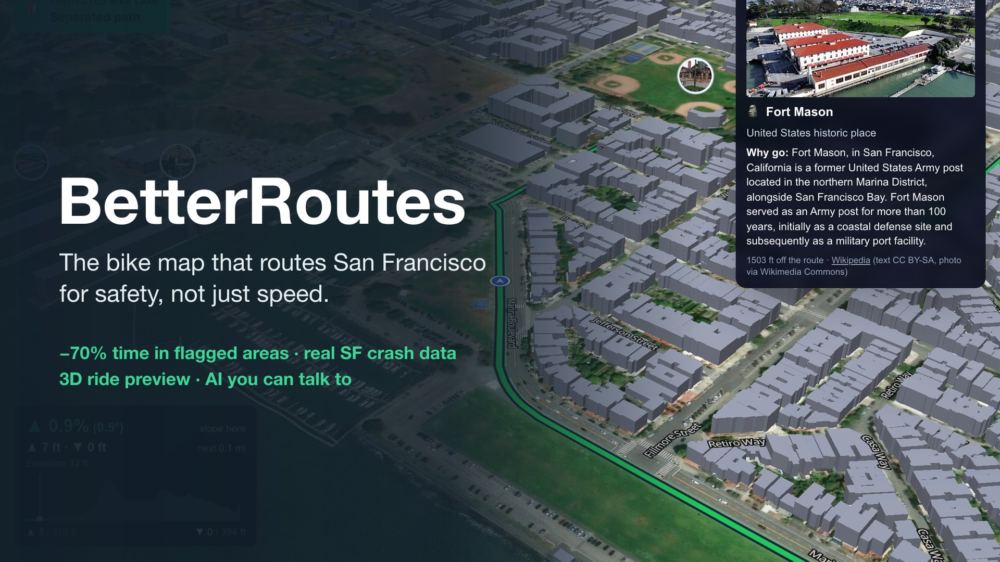

---

## Inspiration

Every map app answers one question for cyclists: *what's the fastest way?* In San Francisco that answer often runs down busy arterials, through unprotected intersections, and straight through the city's worst crash areas.

The numbers are getting worse. In 2024, **1,103 cyclists were killed** on US roads and **52,887 were injured**, up 6% from 2023; 81% of those deaths happen in cities ([NHTSA, 2024](https://rosap.ntl.bts.gov/view/dot/92690)). Yet in San Francisco, just **4% of street miles hold 55% of severe and fatal bike injuries** ([SFMTA Vision Zero High Injury Network](https://sfmta.com/media/4894/download)).

Danger isn't everywhere. It's concentrated, and anything concentrated can be routed around. Meanwhile about half of adults in big US cities say they'd like to bike but worry about safety ([Dill & McNeil, 2016](https://jenniferdill.net/types-of-cyclists/)). For them, the safe route has to be the default, not a setting they have to find.

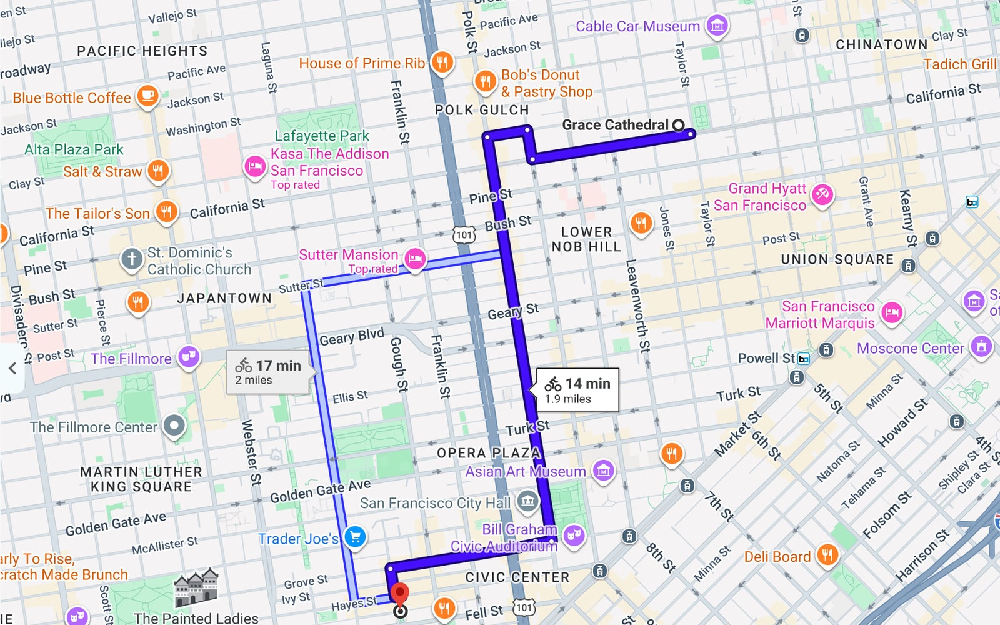
*Google Maps' bike route for Grace Cathedral → Patricia's Green: 39% of the ride is inside areas we rate Severe, and about two-thirds has no protected bike lane.*

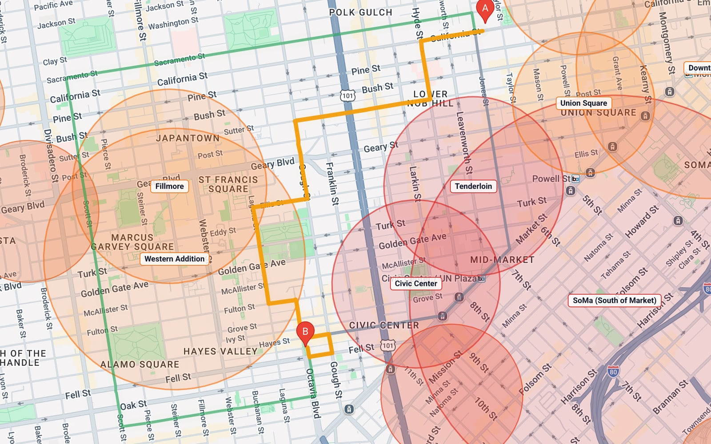
*BetterRoutes' Safest route for the same trip: 0% in Severe areas and no crash hotspots, for 5 extra minutes.*

---

## What it does

Type two San Francisco addresses. BetterRoutes plans three routes on its own street network, scored with real city data, and tells you exactly what each one avoided and what that cost:

- **Fastest**: the quickest ride, counting hills and red lights.
- **Safest**: never enters a Severe area; avoids High and Elevated areas unless that makes the trip more than 40% longer, and then says where and why.
- **Safest + bike lanes**: the same rules, keeping to protected lanes.

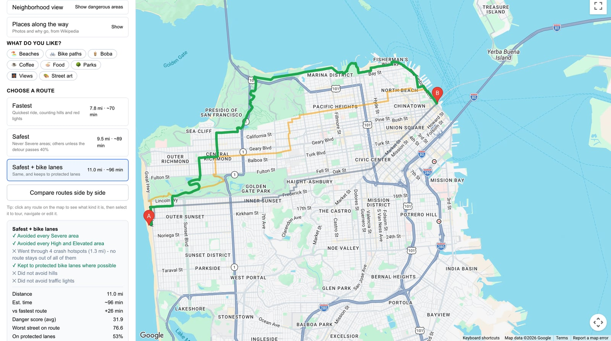

### Safety you can check

- **Honest checklists.** Every route lists what it did and didn't do: "✓ Avoided every Severe area", "✕ Went through 2 crash hotspots (0.6 mi): no route stays out of all of them". It only claims to have "avoided" an area if the fastest route actually goes through it.
- **Neighborhood view** shows the 17 flagged neighbourhoods and clusters of real crashes, so you can see why a route bends where it does.
- **Compare side by side**: every stat, elevation on one shared scale, and the best value in each row starred. There is deliberately no single "best" route; you choose.

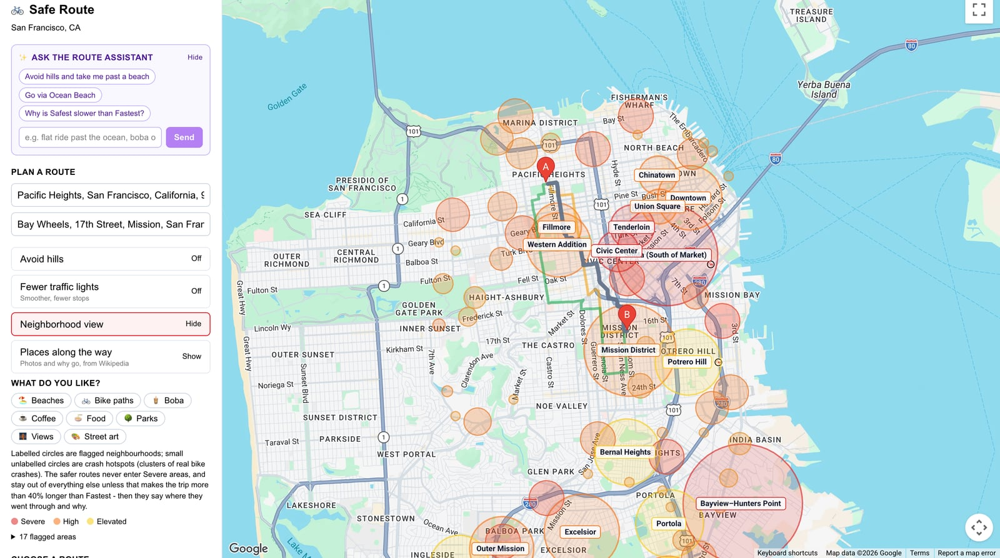
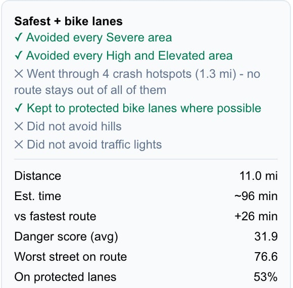
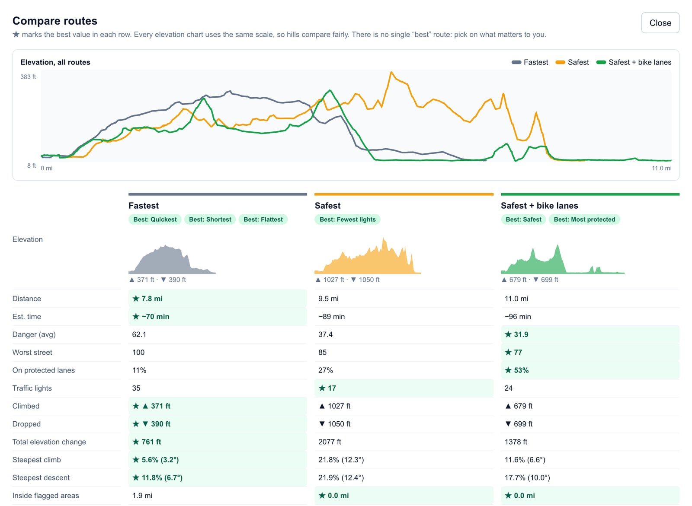

### Rideable, not just safe

- **Avoid hills** uses real terrain grades. On Ocean Beach → Ferry Building it cuts the steepest climb from **21.8% to 8.6%** and halves the climbing (1,027 → 518 ft), and the ride is 7 minutes quicker.
- **Fewer traffic lights**: on the same trip, 35 lights (Fastest) → 17 (Safest) → **12** with this setting on. It never overrides safety.
- **Honest ride times**: every estimate counts each climb and each red light, so "Fastest" is never slower than a safer option.
- **Make it your route**: add or drag stops, and take **suggested edits** with the cost spelled out, e.g. "Skip 221 ft of climbing via Broadway: costs busier streets, +10 traffic lights".

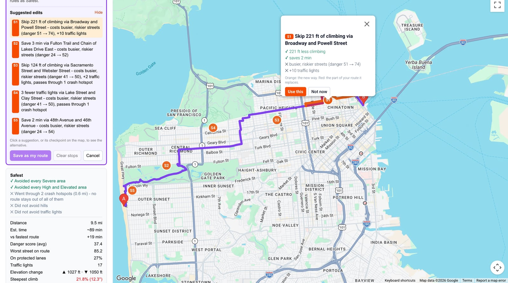

### A ride you'll enjoy

- **AI route assistant.** Type "Flat ride please, with boba and a park on the way" and get a "For you" ride with the stops pinned. The AI can only use the same controls a rider uses, so it cannot break a safety rule, and every change shows up in the sidebar where you can undo it.
- **Rides by interest**: beaches, boba, coffee, food, parks, views, street art or bike paths, from 3,712 real places, never inside a Severe area.
- **Places along the way**: photo cards from Wikipedia with a short "why go".
- **3D preview tour** on real aerial imagery, real terrain and San Francisco's own LiDAR building heights. It calls out protected lanes as you reach them, pops up places you'll pass, warns about steep blocks ahead, and plays at 1×, 2× or 3×.

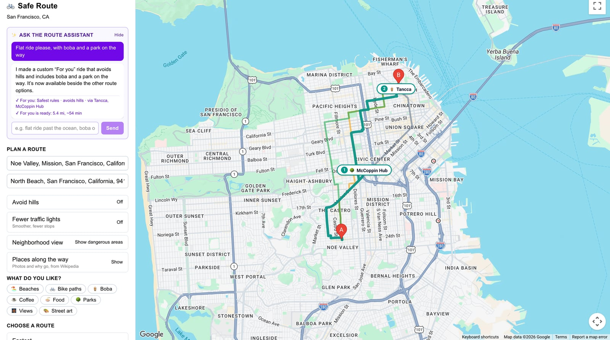
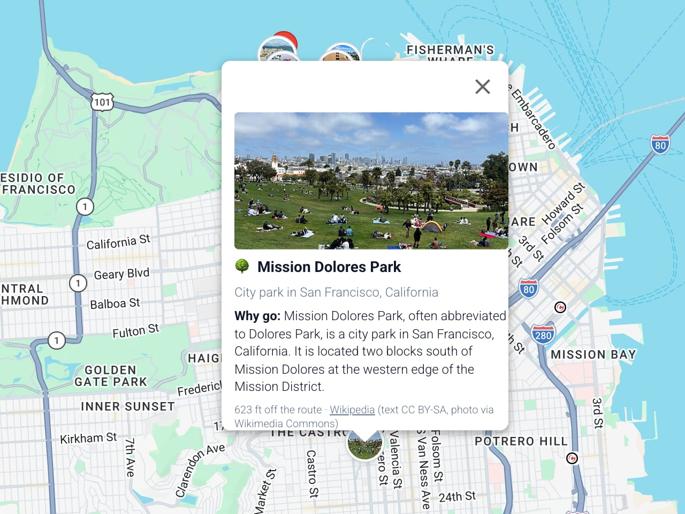
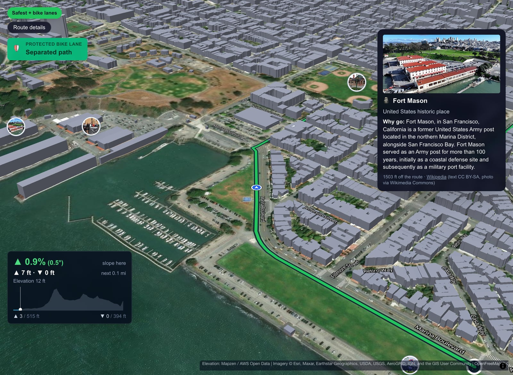
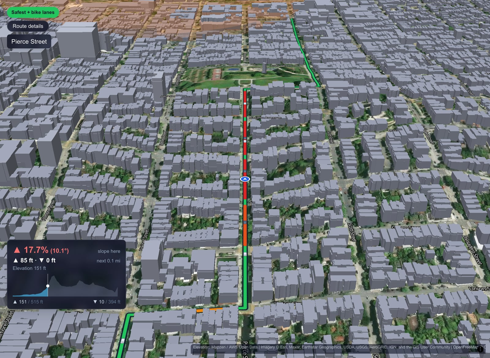

### Ride it

- **Turn-by-turn navigation** with live GPS in a phone browser, rerouting that keeps your safety choice, and a screen-awake lock.
- **Saved rides** keep everything: route, stops, hills, and photos you add at each stop.

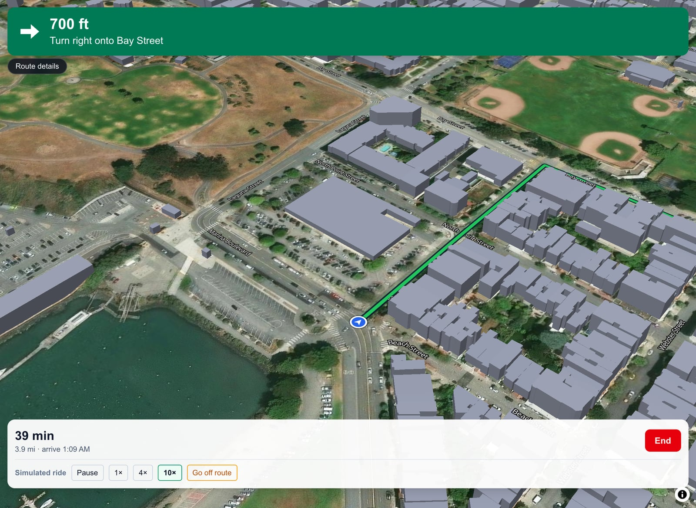

### Results

Across **10 everyday San Francisco trips**, Safest + bike lanes compared with Fastest:

| | Fastest | Safest + bike lanes | Change |
|---|---|---|---|
| Ride inside flagged areas | 45.8% | 13.9% | **−70%** |
| Average street danger (0–100) | 69.6 | 50.3 | **−28%** |
| Ride on protected lanes | 18.5% | 26.2% | **1.4×** |
| Trips entering a Severe area | 7 of 10 | 1 of 10 | |
| Ride time | | | +33%, shown on every route |

Every number can be reproduced live by typing the trip into the app; the full list is in [`EVIDENCE.md`](../EVIDENCE.md).

---

## How we built it

**Our own router instead of Google Directions.** Nudging Google's route with detour points can never *guarantee* avoiding an area, so we built an A\* router over a **211,221-segment** directed graph of San Francisco's streets from OpenStreetMap. It plans all three routes in about 0.1 s on the server.

**Every street scored with real open data:**

| Data | Source |
|---|---|
| 3,558 bike-injury crashes, 2019+ | DataSF, Traffic Crashes Resulting in Injury |
| 5,455 surveyed bike-lane segments | SFMTA Bike Network (authoritative over OpenStreetMap) |
| 5,566 highways and fast arterials | OpenStreetMap |
| 1,314 traffic signals that stop a rider | SFMTA signal inventory |
| Elevation at 112,492 graph points | USGS terrain via AWS Terrain Tiles |
| 177,023 LiDAR-measured buildings | DataSF building footprints |
| 3,712 places · photo cards | OpenStreetMap · Wikipedia / Wikimedia Commons |

**Danger model.** Each street segment gets features (crash density, lane protection, highway and arterial exposure, road class, neighbourhood risk). A scikit-learn model trained on those features scores every segment; training and the live app share one feature extractor, so they can't drift apart. Hills, lights and ride times come straight from measured data.

**Stack**

- **App:** Next.js 16 (App Router), React 19, TypeScript, Tailwind CSS 4.
- **Maps:** Google Maps JavaScript API for the 2D map; MapLibre GL for the 3D tour, on Esri aerial imagery and AWS terrain.
- **AI:** Vercel AI SDK v7 with OpenAI. The assistant calls tools (`set_trip`, `set_settings`, `add_stop`, `improve_route`, `make_for_you_route`…) that map onto the same controls as the UI, with Zod schemas rejecting anything invalid. The key stays server-side.
- **Data pipeline:** Node scripts fetch and clean each dataset into versioned JSON; a Python and scikit-learn pipeline trains the danger model.
- **Quality:** 411 Vitest tests. Many were checked by deliberately breaking the code and confirming the test fails. Every UI flow was verified in a real browser with Playwright.

---

## Challenges we ran into

- **Google's routing and places APIs were closed to us.** Directions returned `REQUEST_DENIED` and Places Autocomplete is closed to new projects, so we built our own router and used OpenStreetMap for address search.
- **The map data disagreed with the city.** Within 20 m of an SFMTA bike facility, OpenStreetMap agreed with the city's lane type only **44%** of the time. It recorded *no* bike infrastructure on 11,148 segments the city lists as fully protected. Making SFMTA's survey authoritative corrected 32,128 lane ratings and doubled protected-lane riding on some trips.
- **"Safest" was quietly returning the fastest route.** A safety-ordering check compared only average danger, so the route that properly avoided dangerous areas was silently swapped back to Fastest under a "Safest" label. It now has to win on danger *and* on flagged-area exposure.
- **The app made false safety claims.** It said "Avoided Tenderloin" on trips nowhere near it, and named the wrong street for protected-lane callouts 9.9% of the time. We made "avoided" counterfactual (the fastest route must actually go there) and fixed an off-by-one distance bug, taking the callout error to 0.04%.
- **Crash counts measure popularity as much as danger.** With 10× more real crashes, Valencia St, 78% protected, ranked as the most dangerous street simply because so many people ride it. Log-scaled crash features fixed the ranking.
- **San Francisco's hills.** Left alone, the safest route sent riders up Jones St at 27.5%, because quiet streets are often steep. Avoid hills uses real terrain grades, including steep descents. Bridges first sampled the bay floor, a fake 99 m plunge, until we re-spanned them from shore.
- **"Fastest" was sometimes slower than "Safest".** Fastest minimised distance, but time depends on hills and red lights. One honest ride-time model now drives every route and estimate, and tests check the ordering on every setting.
- **3D buildings that weren't really there.** Map tiles drew only about a third of downtown's buildings, so we switched to the city's LiDAR footprints. Two silent bugs followed: subtracting ground height from a value that was already above-ground, which discarded 169,000 buildings; and drawing average rather than peak height, which flattened the skyline.

---

## Accomplishments we're proud of

- The safe route is a **promise**, not a suggestion: hard area rules, and checklists that never claim more than they did.
- Measured results: **70% less time in flagged areas** and Severe-area trips down from 7 in 10 to 1 in 10.
- A full product, not a mockup: routing, AI, 3D preview, navigation and saved rides, with **411 automated tests**.

## What we learned

Safety software has to be honest before it is clever. Several of our worst bugs produced no errors at all, only confident wrong answers. Checking every claim against real data and a real browser mattered more than any single algorithm.

## What's next

- **Crash rates instead of counts**, adjusting for how many people ride each street, and learning area risk instead of setting it by hand.
- **Near-miss reports** from riders (BikeMaps.org) alongside crash data.
- **More cities.** Everything runs on open data, so any city with open crash and bike-lane data can follow, starting with Vision Zero cities.
- **A native app** for background GPS and alerts as you approach a danger spot.
- **Helping cities**: anonymous, aggregated detours show exactly where a protected lane is missing.

---

## How it runs

BetterRoutes is a single Next.js app: the browser UI and the API routes (routing, geocoding, places, buildings, the AI assistant) run in one Node.js server. It currently runs locally; it is not yet deployed.

**Requirements:** Node.js 20+, a Google Maps JavaScript API key, and an OpenAI API key for the assistant (optional; everything else works without it).

```bash
git clone git@github.com:ecnelis0/BetterRoutes.git
cd BetterRoutes
npm install
cp .env.local.example .env.local   # add NEXT_PUBLIC_GOOGLE_MAPS_API_KEY and OPENAI_API_KEY
npm run dev                        # http://localhost:3000
npm test                           # 411 tests
```

- The first route after starting takes a few seconds while the street graph loads; after that, routes take about 0.1 s.
- Open `http://localhost:3000/?testmode` to get **Simulate ride** for testing navigation on a laptop.
- For live GPS on a phone, serve over https (e.g. `cloudflared tunnel --url http://localhost:3000`); browsers only share location with secure pages.

## Built with

`next.js` · `react` · `typescript` · `tailwind-css` · `google-maps` · `maplibre-gl` · `openai` · `vercel-ai-sdk` · `zod` · `python` · `scikit-learn` · `pandas` · `vitest` · `playwright` · `openstreetmap` · `datasf` · `sfmta`
